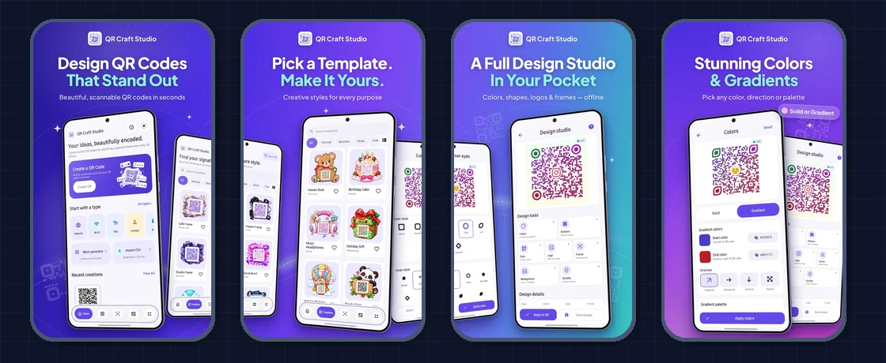
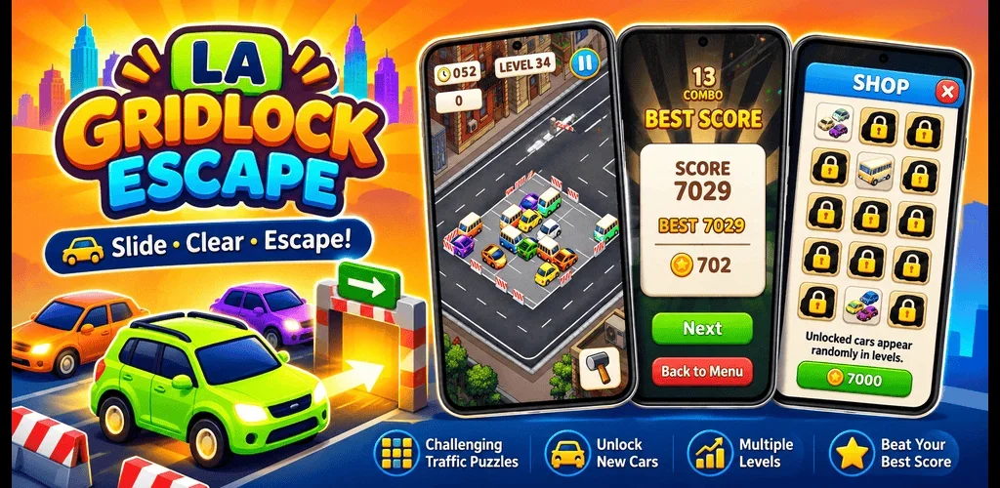

<!-- GitHub profile README for https://github.com/Aamish-Ejaz -->
<!-- Keep README.md and the assets/ folder together in the Aamish-Ejaz/Aamish-Ejaz repository. -->
<h3>I build mobile apps that look premium, work reliably, and solve real problems.</h3>
<strong>Android &amp; Flutter Developer</strong> · <strong>Kotlin / Java / Dart</strong> · <strong>Firebase &amp; REST APIs</strong>

<em>From an idea or an existing codebase to a polished, release-ready mobile product.</em>

  
  
  

  
  
  
  

👋 A little about me
I'm Aamish Ejaz, a mobile app developer focused on building, redesigning, and improving Android and Flutter applications. With 4+ years of professional experience, I work across native Android, modern UI, app integrations, debugging, and delivery preparation.

I care about more than getting an app to compile: clear requirements, thoughtful design, maintainable code, smooth user experience, and dependable handover all matter.
4+ Years	50+ Fiverr Projects	150+ Direct Projects	50+ Public Reviews
Mobile development experience	Freelance delivery	Local & direct client work	Client feedback

<a href="https://aamishejaz.pages.dev/projects"><strong>See 115 app &amp; game case studies in my portfolio →</strong></a>
🛠️ My development toolkit

Mobile engineering	Data & integrations	Quality & delivery
Kotlin, Java, Flutter, Dart	Firebase Auth, Firestore, Realtime Database	Debugging, crashes, Gradle & SDK upgrades
Jetpack Compose, XML, Material UI	REST APIs, JSON, Retrofit	MVVM, clean architecture, coroutines
Responsive UI, reusable components	Room, SQLite, local storage	UI refinement, testing, release assets

🌟 Featured product — QR Craft Studio

<strong>PERSONAL ANDROID PRODUCT · AVAILABLE FOR PRIVATE ACQUISITION OR SOURCE-CODE LICENSING</strong>

QR Craft Studio is an independently developed, offline-first QR creation and design application for brands, creators, businesses, restaurants, and marketers. It brings QR generation, visual customization, printing, exporting, and organization into one product.
47 QR creation options	Advanced design studio	Business-ready workflows
URLs, Wi-Fi, contacts, messaging, social links, menus & more	Gradients, patterns, corner styles, logos, frames & templates	Batch/CSV generation, print layouts, saved library & local backups

- Design & personalize: brand-ready QR codes, logo overlays, templates, and QR designs placed on images.
- Export & print: PNG, JPG, SVG, and PDF, with layouts suited to common print sizes.
- Stay organized: favorites, folders, drafts, history, and an offline-first local library.

<strong>📱 Preview more QR Craft Studio screens</strong>

 

For potential buyers: QR Craft Studio has not been published on Google Play. Commercial acquisition, source-code licensing, customization, and transfer terms are discussed privately. This is a product showcase, not a public code download.

🎮 Selected work — LA Gridlock Escape

A 3D traffic puzzle game where players solve gridlock challenges by moving cars and finding an escape route. This client project is live on Google Play; its source repository is private.

View case study · Open on Google Play
More projects, more variety
Project	Category	Case study
Stunivo: Student Life Planner	Education / productivity	Explore
Bloom Burst	Puzzle game	Explore
SeatWeave	Events / business tools	Explore
Boondocks Restaurants	Food / hospitality	Explore

Explore the complete app portfolio →
🔒 Respecting client confidentiality: Most professional, company, and client project repositories are private. My portfolio showcases appropriate visuals, public-facing features, and project outcomes—not private source code, credentials, or internal business information.

🚀 What I can help you build
Build & launch	Improve & integrate	Design & presentation
Native Android apps (Kotlin / Java)	Bug fixing, crash resolution, SDK updates	Figma to XML / Compose / Flutter
Flutter cross-platform apps	Firebase and REST API integrations	App reskin, redesign & rebranding
Jetpack Compose UI	Push notifications, app improvements	App icons, feature graphics & store screenshots
Website-to-Android conversions	Performance & usability improvements	ASO, privacy-policy materials & launch assets

First-app Google Play preparation: On request, I can deliver a complete agreed package with source code, signed AAB, securely handed-over JKS keystore, app icon, feature graphic, five store-ready screenshots, ASO copy, privacy-policy text, and an optional website. Google Play approval is determined by Google and cannot be guaranteed.

See all services and examples →
💬 What clients value
“Excellent seller! Fast, punctual, and professional! I will definitely work with him again.”

— Client feedback on Fiverr

I prioritize clear communication, careful implementation, reliable updates, and professional delivery—whether the task is a small fix or a complete application.

Read more client feedback on Fiverr →

<h2>🤝 Let's build something worth using</h2>
<strong>Starting a new app? Updating an existing one? Need a release-ready mobile product?</strong>

Tell me what you want to build, your current project stage, and your goals. I'll help turn that into a clear development scope.

 
 
<strong>Clean code · Clear communication · Reliable delivery</strong>

