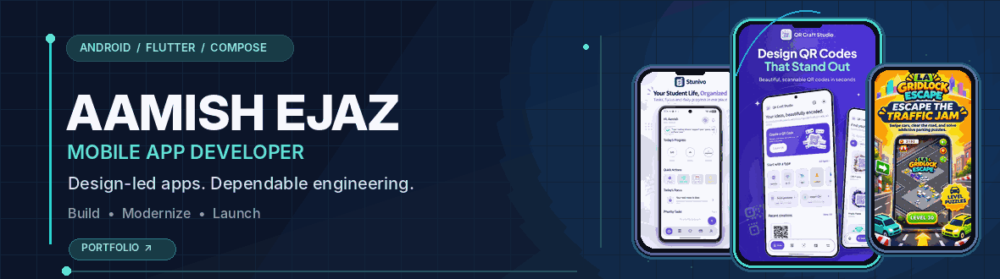
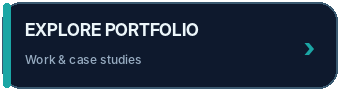
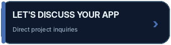
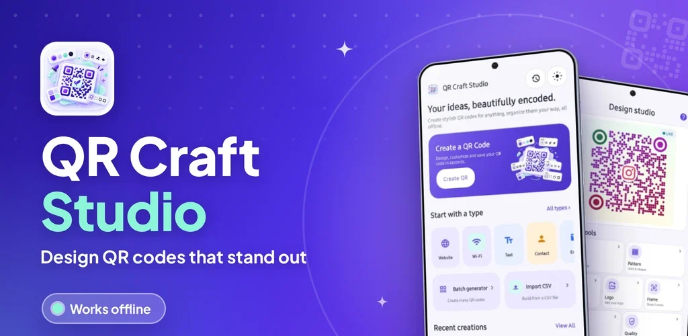
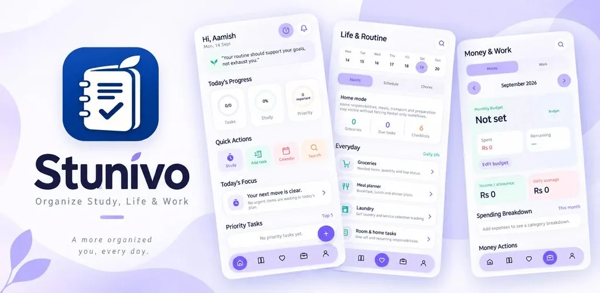
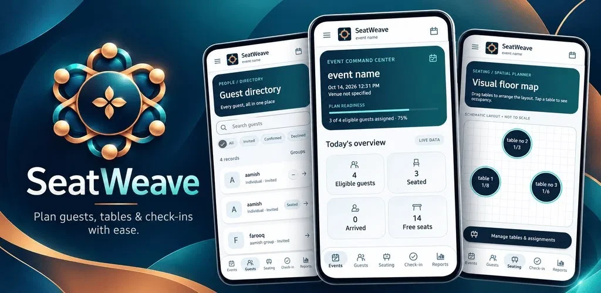
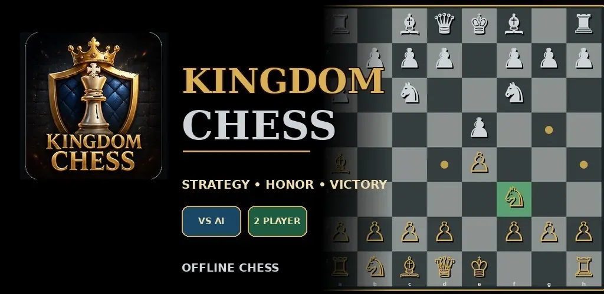
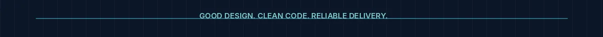

<!--
GITHUB PROFILE README — AAMISH EJAZ
IMPORTANT: upload README.md AND the complete assets/ directory to the ROOT
of your Aamish-Ejaz/Aamish-Ejaz repository. The current repo previously
had no assets/ directory, which is why the previous images did not load.
All key visuals are included locally; no third-party image widget is required.
-->

  
   
  <h3>Android &amp; Flutter developer turning product ideas into polished mobile experiences.</h3>
  
<b>Kotlin · Java · Jetpack Compose · Flutter · Dart · Firebase · APIs</b>

  
From premium interfaces and new products to app rescue, integrations and release preparation.

  

    
    
    
  

  

    <a href="https://www.linkedin.com/in/aamish-ejaz/">LinkedIn</a> &nbsp;·&nbsp;
    <a href="https://github.com/Aamish-Ejaz">GitHub</a> &nbsp;·&nbsp;
    <a href="https://wa.me/923289848592?text=Hi%20Aamish%2C%20I%20want%20to%20discuss%20an%20Android%20app%20project.">WhatsApp</a> &nbsp;·&nbsp;
    <a href="mailto:aamishdeveloper786@gmail.com">Email</a>
  

The work, in numbers
4+ Years	50+ Fiverr Projects	150+ Direct Projects	50+ Public Reviews
Android & mobile development	Delivered through Fiverr	Local & direct client work	Public client feedback

I'm Aamish Ejaz, an Android and Flutter developer focused on UI quality, real-world functionality and dependable project delivery. I build new Android apps, modernize existing ones, solve crashes, connect APIs, and prepare professional release assets.

I work across Kotlin, Java, Jetpack Compose, XML, Flutter/Dart, Firebase, REST APIs, Room/SQLite, and the practical release workflow that makes an app ready for real users.
Selected work
Real app case studies, original feature graphics and public-facing functionality. Click any image to explore the project in detail.

01 — QR Craft Studio PERSONAL PRODUCT · AVAILABLE FOR ACQUISITION

A full-featured QR design product, built for businesses and creators.

QR Craft Studio is my independent, offline-first Android application featuring 47 QR creation options, a visual design studio, ready-made templates, QR-on-image layouts, PNG/JPG/SVG/PDF exports, printing layouts, CSV/batch workflows, and an organized personal QR library with local backup and restore.

This product is available for private acquisition or source-code licensing. It has not been published on Google Play. Commercial terms, licensing scope and pricing are discussed privately.

Explore the complete QR Craft case study   ·   Product website   ·   Request a private acquisition quote
More mobile products and case studies
<table>
<tr>
<td width="50%" valign="top">
  
  <h3>02 · LA Gridlock Escape</h3>
  
<b>Android game · Live on Google Play</b>

  
An isometric traffic-puzzle game built around moving vehicles, clearing a route and solving timed challenges.

  
<a href="https://aamishejaz.pages.dev/projects/la-gridlock-escape">View case study</a> &nbsp;·&nbsp; <a href="https://play.google.com/store/apps/details?id=com.lagridlockescape.puzzle">Google Play</a>

</td>
<td width="50%" valign="top">
  
  <h3>03 · Stunivo</h3>
  
<b>Productivity · Student planning</b>

  
An all-in-one student-life organizer for study plans, tasks, routines, deadlines and personal budgeting.

  
<a href="https://aamishejaz.pages.dev/projects/stunivo-student-life-planner">Explore the project →</a>

</td>
</tr>
<tr>
<td width="50%" valign="top">
  
  <h3>04 · SeatWeave</h3>
  
<b>Business utility · Events</b>

  
Offline event planning with guest lists, tables, seating arrangements and event check-ins.

  
<a href="https://aamishejaz.pages.dev/projects/seatweave">Explore the project →</a>

</td>
<td width="50%" valign="top">
  
  <h3>05 · Kingdom Chess</h3>
  
<b>Offline game · Strategy</b>

  
Classic chess against an AI opponent at different difficulty levels, or local two-player chess on one device.

  
<a href="https://aamishejaz.pages.dev/projects/kingdom-chess">Explore the project →</a>

</td>
</tr>
</table>

  <h3><a href="https://aamishejaz.pages.dev/projects">Discover my complete app &amp; game portfolio →</a></h3>
  Client and company project source repositories are private. Case studies show permitted visuals and product features, not confidential code or credentials.

What I can help you ship
Build & modernize	Integrate & improve	Design & launch
Native Android (Kotlin / Java)	Firebase & REST API integrations	Figma → XML / Compose / Flutter
Flutter & Jetpack Compose	Bug fixes, crash resolution	UI redesign and app rebranding
Website-to-Android apps	Push notifications & app updates	Icons, store graphics and ASO assets
Maintainable application code	Performance and usability improvements	Release preparation and documentation

First-app Play Store delivery packages can include source code, an AAB, secure JKS keystore handover, an app icon, feature graphic, five store screenshots, ASO, privacy-policy text, and an optional privacy-policy website. Google Play approval is not guaranteed and depends on the store's independent review.

Explore development and design services
How I approach projects
01 — Understand	02 — Build with care	03 — Deliver clearly
Clear requirements, scope and user experience priorities	Clean UI, organized code, practical testing and iteration	Reproducible builds, release assets and transparent handover

“Excellent seller! Fast, punctual, and professional! I will definitely work with him again.”

— Client feedback on Fiverr

See public client feedback

<b>Tools & technologies I work with</b>

 
Android: Kotlin, Java, Jetpack Compose, XML, Android SDK, ViewBinding, Material UI
Cross-platform: Flutter, Dart
Data & integrations: Firebase Authentication, Cloud Firestore, FCM, REST APIs, Retrofit, Room, SQLite
Architecture & tooling: MVVM, ViewModel, coroutines, Git, GitHub, Android Studio, Postman, Figma
Delivery: crash fixing, UI refinement, publishing assets, Play Store preparation

  <h2>Have an app idea? Let's bring it to life.</h2>
  
Whether you're planning a new Android product, modernizing an app, or exploring a product acquisition — I'd be glad to discuss the scope.

  

    
    
    
  

  
<a href="https://www.linkedin.com/in/aamish-ejaz/">LinkedIn</a> &nbsp;·&nbsp; <a href="https://qrcraftstudio.pages.dev/">QR Craft Studio</a> &nbsp;·&nbsp; <a href="mailto:aamishdeveloper786@gmail.com">aamishdeveloper786@gmail.com</a>

  

